# ⚡ Awesome-AI-Reverse-Engineering

**Curated Catalog & Guide to AI Reverse Engineering, Agent-Assisted Binary Analysis, Decompilation & Software Reconstruction 🛡️🤖**

*Track leading tools, Model Context Protocol (MCP) servers, symbolic execution engines, and decompilers powering the next generation of automated software analysis.*

**Last updated: October 2026** 📅

---

## 📖 Overview & Ecosystem

Welcome to **Awesome-AI-Reverse-Engineering** 🚀 — the comprehensive index tracking state-of-the-art **SaaS platforms** and **open-source tools** in **AI Reverse Engineering**. These technologies empower cybersecurity researchers, reverse engineers, and developers to explore compiled executables without source code. By orchestrating LLM agents with native decompilers and symbolic execution engines, teams can automatically recover high-level pseudocode from stripped binaries, trace zero-day vulnerabilities, reconstruct software logic, and perform automated malware triage.

- 🔬 **Commercial Category Leaders**: [IDA Pro](https://hex-rays.com/ida-pro/), [Hex-Rays](https://hex-rays.com/), [Binary Ninja](https://binary.ninja/), [JEB Decompiler](https://www.pnfsoftware.com/), and [Hopper](https://www.hopperapp.com/).
- 🌐 **Open-Source Powerhouses**: [REA (Reverse Engineer Anything)](https://github.com/morluto/rea), [Ghidra](https://github.com/NationalSecurityAgency/ghidra), [dnSpy](https://github.com/dnSpy/dnSpy), [ILSpy](https://github.com/icsharpcode/ILSpy), [Radare2](https://github.com/radareorg/radare2), [Frida](https://github.com/frida/frida), [Cutter](https://github.com/rizinorg/cutter), and [Angr](https://github.com/angr/angr).
- 🧩 **Agent & MCP Workflows**: Bridges connecting LLMs (Claude Code, Cursor, Codex, Gemini CLI) to headless decompilation engines for autonomous reverse engineering.

---

## 📑 Table of Contents

- [📊 Sector Overview & Market Dynamics](#-sector-overview--market-dynamics)
- [💼 SaaS / Hosted Platforms](#-saas--hosted-platforms)
- [🔓 Open-Source GitHub Projects (Ranked by Stars)](#-open-source-github-projects-ranked-by-stars)
- [🛠️ Frameworks & Autonomous Architectures](#️-frameworks--autonomous-architectures)
- [🤝 How to Contribute](#-how-to-contribute)
- [💖 Support & Sponsorship](#-support--sponsorship)
- [📈 Star History](#-star-history)
- [⚠️ Disclaimer & Ethical Research Guidelines](#️-disclaimer--ethical-research-guidelines)

---

## 📊 Sector Overview & Market Dynamics

The global software reverse engineering and binary analysis tooling market is valued at approximately **$400M–$450M**, with the broader binary static analysis, firmware security, and software supply-chain inspection sector projected to expand beyond **$4B** by the early 2030s.

The commercial market remains **moderately concentrated** at the top tier—dominated by veteran solution provider Hex-Rays (IDA Pro) alongside high-growth challengers like Vector 35 (Binary Ninja)—while remaining fragmented across specialized niche decompilers (Android, .NET, macOS) and vigorously contested by institutional open-source foundations (notably the NSA's Ghidra). Simultaneously, the emergence of AI agent orchestration (like REA and MCP bridges) is disrupting traditional closed-source moats by turning open-source analysis engines into autonomous reverse-engineering pipelines.

---

## 💼 SaaS / Hosted Platforms

| Product | Company / Developer | Company Size (Revenue / Valuation) | Pricing | Free Tier / Trial Limits | Description |
| :--- | :--- | :--- | :--- | :--- | :--- |
| **[IDA Pro](https://hex-rays.com/ida-pro/)** | Hex-Rays (Smartfin consortium) | ~$22M+ (€20M+) annual revenue; private PE-backed valuation | Starting at $1,099/yr (IDA Pro Essential, cloud decompilers) | No free trial of Pro; offers **IDA Free** limited to x86/x64 binaries with cloud-only decompilation, local debugging, non-commercial use | Industry-standard disassembler and debugger with the Hex-Rays decompiler; mature commercial platform with extensive plugin ecosystem. |
| **[Hex-Rays](https://hex-rays.com/)** | Hex-Rays (Smartfin consortium) | ~$22M+ (€20M+) annual revenue; private PE-backed valuation | Starting at $1,099/yr (bundled via IDA Pro subscriptions) | No free trial of standalone decompiler; accessible via **IDA Free** (x86/x64 cloud decompiler only, non-commercial use) | The decompiler engine powering IDA Pro, converting assembly to high-level pseudocode across multiple architectures. |
| **[Binary Ninja](https://binary.ninja/)** | Vector 35 | ~$3M–$5M estimated revenue ($800K funding backed by In-Q-Tel) | Starting at $199 (Non-Commercial perpetual) / $1,799 (Commercial Named) | **Binary Ninja Free**: Desktop app limited to x86, x86_64, ARMv7, ARMv8 architectures, no Python/C++ API or plugins, non-commercial use; Cloud version requires public binary uploads | Modern reverse engineering platform with clean API, intermediate languages (BNIL), and LLM/agent integration. |
| **[JEB Decompiler](https://www.pnfsoftware.com/)** | PNF Software | ~$1M–$3M estimated revenue (Bootstrapped, 3–10 employees) | Starting at $140/mo or $1,200/yr (JEB Android) / $2,000/yr (JEB Pro) | **JEB Community Edition (JEB CE)**: Free for non-commercial use, limited to x86/x64 desktop binaries (no Android Dalvik decompiler); **JEB Demo**: Free trial with no project save/load, clipboard disabled, time-limited sessions, partial decompilation | Commercial decompiler and reverse engineering suite specializing in Android APK/Dalvik bytecode and multi-architecture targets. |
| **[Hopper](https://www.hopperapp.com/)** | Cryptic Apps | ~$300K–$700K estimated revenue (Indie micro-ISV, 1 developer) | Starting at $99 (Personal perpetual license with 1 year of updates) | **Free Demo**: Session time-limited to 30 minutes, saving and exporting disabled, debugger disabled | macOS/Linux/Windows disassembler and decompiler with native UI, specialized in Mach-O, Swift, and Objective-C binary analysis. |

---

## 🔓 Open-Source GitHub Projects (Ranked by Stars)

*All repositories are sorted in descending order of popularity based on GitHub stars.*

1. **[REA (Reverse Engineer Anything)](https://github.com/morluto/rea)**   
   **The leading open-source AI reverse engineering agent platform** (MIT). Over 260,000+ GitHub stars. Acts as an MCP server connecting AI coding agents to Ghidra, Hopper, IDA, and native analysis engines. Analyzes native binaries (Mach-O, ELF, PE), JavaScript/Electron apps, .NET assemblies, Android APKs, firmware, and network captures, feeding structured call graphs and decompiled code into Claude Code, Codex, Cursor, and Gemini CLI.

2. **[Ghidra](https://github.com/NationalSecurityAgency/ghidra)**   
   **The NSA's flagship software reverse engineering suite** (Apache-2.0). 88,000+ GitHub stars. Comprehensive decompiler, disassembler, debugger, and scripting framework across x86, ARM, MIPS, PowerPC, and RISC-V architectures. Serves as the backbone decompiler for most modern open-source AI agent integrations.

3. **[dnSpy](https://github.com/dnSpy/dnSpy)**   
   **Legendary .NET debugger and assembly editor** (GPL-3.0). 29,000+ GitHub stars. Decompiles .NET assemblies to readable C#/IL, with in-place IL editing and robust step-debugging even without original source code or symbol files.

4. **[ILSpy](https://github.com/icsharpcode/ILSpy)**   
   **The open-source .NET assembly browser and decompiler** (MIT). 26,000+ GitHub stars. Cross-platform decompilation engine with syntax highlighting, PDB generation, BAML-to-XAML conversion, and extensibility via C# plugins.

5. **[Radare2](https://github.com/radareorg/radare2)**   
   **Unix-centric reverse engineering framework and CLI toolset** (LGPL-3.0). 25,000+ GitHub stars. Disassembles, debugs, analyzes, and patches native binaries with high scriptability, micro-footprint, and support for dozens of architectures.

6. **[Frida](https://github.com/frida/frida)**   
   **Dynamic binary instrumentation toolkit for developers and reverse engineers** (wxWindows Library Licence). 22,000+ GitHub stars. Inject JavaScript snippets or custom libraries into native processes on Windows, macOS, Linux, iOS, and Android to hook APIs and inspect memory on the fly.

7. **[Cutter](https://github.com/rizinorg/cutter)**   
   **Free and user-friendly GUI reverse engineering platform** (GPL-3.0). 20,000+ GitHub stars. Powered by Rizin with native integration of the Ghidra decompiler, graphing capabilities, memory hex editing, and debugger controls.

8. **[GhidraMCP](https://github.com/LaurieWired/GhidraMCP)**   
   **The original Model Context Protocol (MCP) server for Ghidra** (Apache-2.0). 11,000+ GitHub stars. Connects LLMs directly to running Ghidra headless/GUI instances, allowing AI agents to query functions, decompile routines, inspect data types, and rename symbols programmatically.

9. **[YARA](https://github.com/VirusTotal/yara)**   
   **The pattern matching swiss-knife for malware researchers** (Apache-2.0). 9,900+ GitHub stars. Provides rule-based textual and binary pattern classification, widely automated by AI reverse-engineering agents to generate signature detection rules.

10. **[Angr](https://github.com/angr/angr)**   
    **Powerful binary analysis and symbolic execution platform** (BSD-2-Clause) from UC Santa Barbara. 9,100+ GitHub stars. Combines static analysis with concolic execution, vulnerability discovery, and automated exploit primitive generation.

11. **[Capstone](https://github.com/capstone-engine/capstone)**   
    **The ultimate multi-platform, multi-architecture disassembly framework** (BSD-3-Clause). 9,100+ GitHub stars. Powers disassemblers across ARM, ARM64, MIPS, x86, PowerPC, Sparc, SystemZ, XCore, and WebAssembly.

12. **[Qiling](https://github.com/qilingframework/qiling)**   
    **Advanced cross-platform, cross-architecture binary emulation framework** (Apache-2.0). 6,100+ GitHub stars. Emulates full OS syscalls and environments for Windows, Linux, macOS, Android, and IoT embedded firmware.

13. **[LIEF](https://github.com/lief-project/LIEF)**   
    **Library to Instrument Executable Formats** (Apache-2.0). 5,500+ GitHub stars. Parse, modify, and inject payloads into ELF, PE, and Mach-O executables via clean C++ and Python APIs.

14. **[Triton](https://github.com/JonathanSalwan/Triton)**   
    **Dynamic Binary Analysis (DBA) & Concolic Execution engine** (Apache-2.0). 4,300+ GitHub stars. Features symbolic execution, taint analysis, AST representation, and constraint solving via Z3.

15. **[Rizin](https://github.com/rizinorg/rizin)**   
    **Modern, modular UNIX-like reverse engineering framework** (LGPL-3.0). 3,900+ GitHub stars. High-stability fork of Radare2 serving as the core engine powering the Cutter GUI and disassembly pipelines.

16. **[rev.ng](https://github.com/revng/revng)**   
    **Advanced static binary translator and decompiler** built on top of LLVM (GPL-2.0 / Apache-2.0). 1,750+ GitHub stars. Lifts machine code from multiple architectures to clean LLVM IR for optimization and decompilation.

17. **[iaito](https://github.com/radareorg/iaito)**   
    **The official Qt graphical user interface for Radare2** (LGPL-3.0). 1,700+ GitHub stars. Clean desktop interface for disassembling, hex editing, and visual debugging with radare2.

18. **[Open-ReverseLab](https://github.com/LING71671/open-reverselab)**   
    **AI reverse-engineering agent platform and MCP server** (MIT). 1,200+ GitHub stars. Integrates Ghidra, Frida, x64dbg, and Rizin with 100+ MCP tools and runnable security knowledge base articles.

19. **[Veles](https://github.com/codilime/veles)**   
    **Open-source binary data visualization tool** (Apache-2.0). 1,200+ GitHub stars. Visualizes file entropy, structure, and statistical patterns to detect encryption, compression, and obfuscation.

20. **[OGhidra](https://github.com/LLNL/OGhidra)**   
    **AI-driven binary analysis framework from Lawrence Livermore National Laboratory** (BSD-3-Clause). 450+ GitHub stars. Uses locally hosted agentic AI for automated malware triage and RAG-powered semantic search across decompiled functions.

---

### 🧩 Autonomous Agent Packages & MCP Bridges

- **[CutterMCP+](https://pypi.org/project/iflow-mcp_restkhz-CutterMCP-plus/)** — **MCP server for Cutter & Rizin**. Exposes granular tool functions (`list_functions`, `decompile`, `xrefs_to`, `rename_function`) enabling LLM agents to solve complex reverse engineering CTF challenges and unpack anti-analysis logic autonomously.
- **[Reversecore MCP](https://pypi.org/project/reversecore-mcp/)** — **Security-hardened MCP server** integrating Radare2, Ghidra, YARA, LIEF, Capstone, Angr, and Volatility3 within sandboxed containers.
- **[Kong](https://pypi.org/project/kong-re/)** — **Autonomous agentic reverse engineer** performing call-graph bottom-up analysis, removing control-flow flattening, decrypting strings, and synthesizing structs without human guidance.
- **[AIDebug](https://pypi.org/project/1200km-aidebug/)** — **AI-assisted malware debugging companion** combining static parsing with dynamic Frida hooks to generate automated MITRE ATT&CK mappings and analyst reports.

---

## 🛠️ Frameworks & Autonomous Architectures

To build an enterprise-grade, self-hosted autonomous AI reverse engineering pipeline:
1. **Orchestrator**: Use **REA** or **Reversecore MCP** to expose tools to coding agents (Claude Code, Cursor, Codex).
2. **Decompiler & AST Recovery**: Drive **Ghidra** or **Rizin / Cutter** headlessly for decompilation and control-flow graphs.
3. **Symbolic Verification**: Leverage **Angr** or **Triton** to solve constraints, bypass license checks, or prove vulnerability exploitability.
4. **Deobfuscation & Clean-up**: Deploy **Kong** or LLM pipelines to de-flatten obfuscated code, decrypt embedded strings, and reconstruct struct definitions.
5. **Runtime Validation**: Use **Frida** or **Qiling** for dynamic instrumentation and multi-architecture emulation.

---

## 🤝 How to Contribute

Contributions are warmly welcomed! 🌟 To add or improve tools:

1. 🍴 Fork the repository.
2. 🌿 Create a feature branch: `git checkout -b add-tool-name`.
3. 📝 Add your entry under either [💼 SaaS / Hosted Platforms](#-saas--hosted-platforms) or [🔓 Open-Source GitHub Projects](#-open-source-github-projects-ranked-by-stars) adhering to formatting standards.
4. 📬 Submit a Pull Request with a clear description and links.

Please ensure all submissions adhere to factual information, ethical guidelines, and lawful security research practices.

---

## 💖 Support & Sponsorship

If you find **Awesome-AI-Reverse-Engineering** helpful for your research, projects, or organization, please consider showing your support:

- ⭐ **Star this repository** on GitHub to help others discover it!
- 🍴 **Fork and share** with security researchers, reverse engineers, and developers.
- ☕ **Sponsor or buy a coffee**: Support ongoing curation and maintenance via the [GitHub Sponsor Dashboard](https://github.com/sponsors/ishandutta2007).

Thank you for being part of this open and collaborative community! 🙌

---

## 📈 Star History

---

## ⚠️ Disclaimer & Ethical Research Guidelines

- 🛡️ This repository is a **community-curated index** intended strictly for educational, security research, interoperability, malware defense, and software preservation purposes.
- ⚖️ Reverse engineering tools must always be used in compliance with applicable laws, copyright regulations, terms of service, and authorization boundaries. Always ensure proper permissions prior to analyzing proprietary or third-party software.
- 🔒 **Security Best Practices**: Never run unvetted or untrusted binaries directly on your primary host. Always analyze untrusted samples within hardened sandboxes, ephemeral containers, or dedicated virtual machines.
- 📜 Commercial tools mentioned (IDA Pro, Binary Ninja, JEB, Hopper) retain their respective proprietary licenses and trademarks.

---

  <b>Crafted with ❤️ for security researchers, reverse engineers, and builders of transparent AI binary analysis systems.</b>

